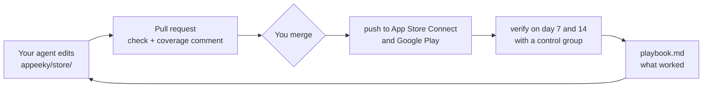

# Appeeky Spec


**App growth, run by your coding agent.**

Appeeky Spec puts your app's whole growth loop in one folder of your repo: the store listing and the searches it should win, reviews and competitors, what AI assistants say about the app, ads, experiments, and what every past change did. Your coding agent (Claude Code, Codex, Cursor, Gemini CLI and others) reads it and proposes the next change as a pull request. You merge it. The change is checked against the store rules, pushed to App Store Connect and Google Play, and measured on day 7 and day 14, and the result goes into a playbook the next change starts from.

[](https://www.npmjs.com/package/@appeeky/spec) [](https://github.com/appeeky/appeeky-spec/actions/workflows/ci.yml) [](LICENSE)

> **Status: 0.x.** Commands and file formats can still change between minor versions. See the [changelog](CHANGELOG.md).

## Quick start

```bash
npx @appeeky/spec init          # finds your app, pulls the listing, suggests targets, adds CI
npx skills add appeeky/appeeky-spec   # teaches your coding agent the workflow
```

Then ask your agent something like *"we're launching in Germany next week"* or *"why did we drop for white noise?"*. It works with the same commands you can run yourself:

```bash
npx @appeeky/spec doctor        # what is set up, what is missing, how to fix it
npx @appeeky/spec coverage      # which searches each storefront is found for
npx @appeeky/spec check         # store limits and ASO rules
npx @appeeky/spec diff          # the spec against the live store
npx @appeeky/spec push --note "Lead with white noise in the US"
npx @appeeky/spec verify        # day 7 and day 14: did it work?
```

`pnpm dlx`, `yarn dlx` and `bunx` work the same way. Node 20 or later.

`init` with no options asks for the app's name, finds it on the App Store, checks the Google Play package, pulls every store it can reach, suggests five targets from what the app already ranks for, offers the GitHub workflows (`--ci`) and the agent skills, and ends on the first coverage table. With options (`--name`, `--app-store`, `--google-play`, `--pull`) it does the same without questions, for scripts. It also adds `.appeeky/` to `.gitignore`.

## What it does

| Feature | What you get |
| --- | --- |
| **Listing as code** | Name, subtitle, keywords, descriptions and what's new for every locale, as YAML in your repo. Changes go through pull requests like code. |
| **Checked before it ships** | Store limits, wasted keyword space, words repeated between name, subtitle and keyword field, Google Play title policy and screenshot sizes. |
| **Keyword coverage** | Which of your target searches each storefront indexes, weighted by popularity, with words to add and the spare space in secondary locales. |
| **Pushed to both stores** | App Store Connect and Google Play, with your own keys or through your Appeeky connection. Every push writes a release file; `revert` puts the old values back. |
| **Measured** | Day 7 and day 14: search ranks, conversion, downloads, revenue and ads, against storefronts the release did not change. The verdict goes into `appeeky/playbook.md`. |
| **What users and rivals say** | Reviews with a summary and drafted replies, competitors' listings and moves, and the category chart rank, one row a day. |
| **AI visibility** | Whether ChatGPT, Claude, Gemini and Perplexity name your app, who they name instead and the pages they cite. |
| **Ads and data** | Apple Search Ads, Meta and TikTok spend and installs, App Store Connect, Google Play and RevenueCat numbers as CSV your agent can read. |
| **Specialists and a co-founder** | Six read-only specialist subagents (ASO, reviews, ads, releases, UGC, social) and a co-founder review that starts them, writes a brief to `appeeky/briefs/` and opens a pull request with one listing change. Run it as `/appeeky-cofounder`, or once a week on your Claude plan. |

## How a change goes live



Nothing reaches the stores until a person merges. The merge is the approval.

## Where it runs

| Where | How |
| --- | --- |
| **GitHub Actions** | `init --ci` writes three workflows: a check on every pull request, a push on merge, and a daily run that measures and commits. See [In pull requests](#in-pull-requests). |
| **Your own server** | `docker compose up -d` on any VM: Hetzner, DigitalOcean, AWS, Google Cloud, Railway, Fly.io, Render or a machine in your office. See [Running without GitHub Actions](#running-without-github-actions). |
| **Your computer** | Every command runs locally with `npx`. `examples/weekly/` has a cron script for the weekly co-founder review. |
| **Other CI** | GitLab, Bitbucket or CircleCI: the same three triggers and commands. |

Powered by [Appeeky](https://appeeky.com). Works with your own store keys on your machine, or with your Appeeky connection when you'd rather not handle keys.

## Layout

```
appeeky.spec.yaml                 # app, stores, target keywords per storefront
appeeky/
  store/
    app-store/en-US.yaml          # name, subtitle, keywords, promotionalText, description, whatsNew, URLs
    google-play/en-US.yaml        # title, shortDescription, fullDescription, video
  releases/                       # one file per push: what changed, where, why
  reviews/                        # customer reviews (JSONL per month), summary.md, replies/ drafted for review
  competitors/                    # one file per competitor: listing, ranks, recent reviews
  visibility/<country>.yaml       # what ChatGPT, Claude, Gemini and Perplexity answer: named or not, who instead, cited pages
  seo/                            # Google Search Console for the website: clicks per day, queries, pages, summary.md
  search-ads/                     # Apple Search Ads on your own key: spend and installs per day, keywords, search terms
  category.csv                    # rank in the category chart, one row a day
  playbook.md                     # what worked and what did not for this app
.appeeky/data/                    # analytics, ads and revenue as CSV (gitignored; data.commit moves it to appeeky/data/)
```

`appeeky.spec.yaml`:

```yaml
version: 1
app:
  name: Sleep Sounds
  primaryLocale: en-US
stores:
  appStore:
    appId: "1234567890"
    via: auto          # auto | local | hosted
  googlePlay:
    packageName: com.example.sleep
    via: auto
targets:               # the searches this app should be found for, per storefront
  us: [sleep sounds, white noise, rain sounds, brown noise]
  tr: [uyku sesleri, beyaz gürültü]
storefronts:           # optional: which App Store listing locales a storefront indexes
  us: [en-US, es-MX]
```

A field you leave out of a listing file is not managed by the spec: it is never diffed or pushed. You can adopt the spec one field or one locale at a time.

## Commands

| Command | What it does |
| --- | --- |
| `init` | Create `appeeky.spec.yaml` and `appeeky/`. `--pull` fetches the live listings right away. |
| `pull` | Write the live listings into `appeeky/store/` (overwrites local files). |
| `check` | Store limits, ASO rules and screenshot sizes. Exits 1 on errors (`--strict`: on warnings too). |
| `coverage` | Which target keywords each storefront indexes, plus tips for storefronts that read a second locale (the US also reads Spanish (Mexico)). |
| `suggest` | Words to add to a keyword field: missing target words first, then Appeeky keyword opportunities. `--apply <words…>` adds them. |
| `diff` | Field-level differences between the spec and the live store, and what cannot be pushed yet. |
| `push` | Check, diff, confirm, record search ranks, push, and write `appeeky/releases/<id>.yaml`. `--note` stores why, `--create-version 2.5.0` opens the next App Store version first. |
| `verify` | On day 7 and day 14 after a push, compare ranks with the ones recorded before it and write the verdict into the release. With `APPEEKY_API_KEY`, also conversion, downloads, revenue and ads (Apple Search Ads, Meta, TikTok). `--playbook` adds a line to `appeeky/playbook.md`. |
| `ads` | Spend, installs and cost per install of your paid channels over the last `--days` (default 30): Apple Search Ads, plus the Meta and TikTok campaigns under `ads:`. `--save` writes them to `appeeky/ads/<date>.yaml`. Needs `APPEEKY_API_KEY`. |
| `reviews pull\|list\|reply\|push` | Customer reviews from both stores into `appeeky/reviews/`, with `summary.md`. `reply <id> --text` drafts an answer in `appeeky/reviews/replies/` for a pull request; `push` sends the drafts. |
| `competitors discover\|pull` | `discover` lists apps like yours (`--add <n>` puts them in the spec). `pull` writes each competitor's listing, the searches it ranks for and its recent reviews to `appeeky/competitors/`. |
| `visibility init\|sync\|pull\|scan` | AI visibility: whether ChatGPT, Claude, Gemini and Perplexity name your app. `init` writes the intents and prompts Appeeky tracks into the spec, `sync` sends your edits back, `pull` writes the answers to `appeeky/visibility/`, `scan` asks the assistants now. Needs `APPEEKY_API_KEY`, or with `init --local` / `scan --local` your own OpenAI, Anthropic, Gemini or Perplexity key. |
| `search-ads pull` | Apple Search Ads on your own API key: this app's spend, installs, keywords and search terms in `appeeky/search-ads/`, with the search terms that installed and are not targets yet. `ads` and `verify` read it. |
| `seo check\|llms\|pull\|ranks\|keywords\|domain` | The app's website in Google and in AI answers. `check` lists what is missing for search, for the app and for AI crawlers; `llms` writes llms.txt from the listing; `pull` writes Search Console clicks, queries and pages to `appeeky/seo/` (`GSC_CREDENTIALS`). On your own DataForSEO account: `ranks` (Google positions of the site and the store page, and AI Overview citations), `keywords` (volume, difficulty, ideas) and `domain` (what the site ranks for, competing sites). |
| `category pull` | Record today's rank in the category chart (top 100) in `appeeky/category.csv`. App Store needs no key; Google Play needs `APPEEKY_API_KEY` and `category.googlePlay`. |
| `data pull` | App Store Connect, Google Play, Apple Search Ads, RevenueCat, Meta and TikTok numbers per day, and attribution by source, keyword and smart link, as CSV files with an index (`--days`, default 90). |
| `status` | Every change being measured, in one list: releases and experiments, the metric that decides each, the next check and the result so far. Flags checks that are late, releases measured over the same days, and results built on too few installs. Rewrites `appeeky/loops.md`. |
| `log` | Releases pushed from this spec. `--markdown` for changelogs and PR descriptions. |
| `revert <release>` | Put the values from before a release back into the spec. Then `push`. |
| `experiment add\|list\|close` | Track growth experiments outside the listing (screenshots, UGC, ads, pricing) with one metric and a check date. |
| `screenshots pull\|check` | Download the live App Store screenshots into `appeeky/screenshots/` and check their sizes. |
| `report` | Markdown for a pull request: listing changes, check results and coverage against `--base`. |
| `social pull\|check\|push` | Organic social media through the accounts connected in Appeeky (X, Instagram, TikTok, LinkedIn, Pinterest, Reddit, YouTube, Threads, Facebook, Bluesky): `pull` writes the accounts, recent posts (made through Appeeky and in each platform's app), how they did, comments and followers to `appeeky/social/`; `check` checks the drafts in `appeeky/social/drafts/`; `push` sends them. Needs `APPEEKY_API_KEY`. |
| `social comments\|reply\|hide\|like\|delete-comment` | Comments on your posts: `comments` lists them (`--unanswered`, `--account`, `--post`, `--limit`); `reply <id> "<message>"` answers from the account it is on, after checking the platform's reply limit; `hide <id>` (`--unhide`), `like <id>`; `delete-comment <id>` asks first, or needs `--yes` outside a terminal. Needs `APPEEKY_API_KEY`. |
| `ugc pull\|generate` | UGC from your Appeeky creator personas: `pull` writes the personas and their clips to `appeeky/ugc/`; `generate` makes a clip from each brief in `appeeky/ugc/briefs/` (`--dry-run` shows the cost in media credits). Needs `APPEEKY_API_KEY`. |
| `agents install` | Write the specialist subagents and the `/appeeky-cofounder` review into `.claude/` (`--for opencode` or `all` for `.opencode/`). Files you changed are kept unless `--force`. |

Global options: `--json` for machine-readable output, `--cwd <dir>`, `--via auto|local|hosted`.

## Connecting to the stores

Appeeky Spec talks to the stores through the Appeeky store CLIs, which expose the same operations locally and on Appeeky's hosted gateways:

| `via` | How | Needs |
| --- | --- | --- |
| `local` | Runs [`appstore`](https://github.com/appeeky/app-store-connect-cli) and [`gps`](https://github.com/appeeky/google-play-console-cli) on your machine with your own keys. Falls back to `npx` when they are not installed. | An App Store Connect API key (`appstore accounts add`) or a Google Play service account. |
| `hosted` | Calls `asc-api.appeeky.com` and `gps-api.appeeky.com`. Your store keys stay in Appeeky. | `APPEEKY_API_KEY` and a connected store in Appeeky. |
| `auto` | Local when the CLI is installed, hosted when `APPEEKY_API_KEY` is set, `npx` otherwise. | |

**Your own keys, saved once.** Both CLIs keep named accounts in your user config (`~/.config/appstore/`, `~/.config/gps/`), never in the repo. `init` offers to save them for you; by hand:

```bash
npx -p @appeeky/app-store-connect-cli appstore accounts add my-team \
  --key-id ABC123DEFG --issuer-id <issuer-id> --private-key-path ~/AuthKey_ABC123DEFG.p8 --default
npx -p @appeeky/google-play-store-cli gps accounts add my-co \
  --credentials ~/play-service-account.json --default-package com.example.sleep --default
```

With several teams or clients, pick the account per app in the spec: `stores.appStore.account` and `stores.googlePlay.account`. In CI, pass the same keys as environment variables instead (`ASC_KEY_ID`, `ASC_ISSUER_ID`, `ASC_PRIVATE_KEY`, `GOOGLE_APPLICATION_CREDENTIALS`). The CLIs also work on their own, and as MCP servers for your agent (`appstore-mcp`, `gps-mcp`).

### What can change when

- **App Store:** name, subtitle, keywords, description, what's new and URLs change only with a new version. Create the version in App Store Connect (or `appstore versions create 2.5.0 --confirm`), then push. Promotional text changes on the live version at any time. `diff` marks changes that are blocked and says why.
- **Google Play:** listing changes go live without an app update. A new language needs a title, short description and full description.

## Measuring a release

`push` records the search rank of every target right before it changes anything. `verify` checks them again on day 7 and day 14:

- **won**: more targets rose than fell
- **lost**: one top-10 target or two top-20 targets fell out of the top 20 by 10+ places (consider `revert`)
- **mixed** or **flat** otherwise

**A control group.** Storefronts whose listing the release did not change are measured over the same days. A push to en-US changes the US store; the German store reads de-DE and did not change, but its ranks still move with the store's algorithm, the season and competitors. When the changed storefronts gained less than 2 places per target beyond the unchanged ones, a "won" becomes **mixed**: the store moved, not the listing. The check records both moves and the net (`control`).

**Normal moves.** Before comparing conversion, installs or revenue, `verify` reads the four windows before the push and learns how much each metric moves on its own. A change inside that range is **flat**, and the output says so: `downloads/day 100 → 120 (+20%) (moves ±41% on its own)`.

When no target moved (or the release has no targets), the outcomes decide instead: organic installs and their revenue with `attribution:`, otherwise store conversion, otherwise downloads, otherwise the category rank from `appeeky/category.csv`. Better is **won**, worse is **lost**, and the check says so (`decidedBy`).

Ranks come from the Appeeky API when `APPEEKY_API_KEY` is set (both stores), or from Apple's public search for the App Store. Run `verify --playbook` on a schedule (CI or cron) and the playbook fills itself.

With `APPEEKY_API_KEY`, `verify` also compares the days before and after the push for the data you connected in Appeeky: conversion, downloads and proceeds from App Store Connect or Google Play, revenue and trials from RevenueCat, installs and cost per install from Apple Search Ads, spend, installs and cost per install of the Meta and TikTok campaigns listed under `ads:` (see below), and how often AI assistants name the app (`ai_visibility`, see below). Ranks tell you whether more people find the app; these tell you whether more of them install and pay. Experiments on these metrics (`experiment add --metric trial_conversion`) measure their own baseline and result.

## Paid channels

Apple Search Ads is matched to the app in Appeeky, so it needs nothing in the spec. Meta and TikTok ad accounts usually promote more than one app, so list the campaigns that belong to this one:

```yaml
ads:
  meta:
    adAccount: act_1234567890      # optional: defaults to the account picked in Appeeky
    campaigns: ["120210000000001"]
  tiktok:
    advertiser: "7000000000000"    # optional: defaults to the advertiser picked in Appeeky
    campaigns: ["1790000000000"]
```

Connect Meta and TikTok in Appeeky first. Then:

- `appeeky-spec ads` prints spend, installs (conversions for TikTok) and cost per result per channel. `--save` keeps a copy in `appeeky/ads/` so the repo has the history next to the listing.
- `verify` compares those numbers before and after every push, so a listing change and an ad change are judged on the same days.
- Experiments can use `meta_cpi`, `meta_installs`, `tiktok_cpa`, `tiktok_conversions`, `cpa` or `ad_installs` as their metric: `experiment add --type ads --metric meta_cpi` takes its baseline from the last days and `verify` closes it.

## Reviews, competitors and data

Everything an agent needs to decide the next change, as plain files next to the listing. All three need `APPEEKY_API_KEY` and the stores connected in Appeeky.

**Reviews.** `reviews pull` writes every review to `appeeky/reviews/<store>/<YYYY-MM>.jsonl`, one JSON object per line (id, rating, title, body, territory or language, version, date, reply). Pulling again adds new reviews and replaces edited or answered ones. `summary.md` has the last 30 days against the 30 before, star counts, ratings per version, the low ratings still waiting for a reply, and the words users use that your listing does not: phrases that come up in three or more reviews and appear nowhere in any listing, with how many came from 1–3 star reviews. They are candidates for targets, or for the product. Replies go through review like the listing:

```bash
appeeky-spec reviews list --rating 1-2 --unanswered
appeeky-spec reviews reply 1234567 --text "Sorry about that. 3.1 fixes the crash on launch."
git checkout -b reviews/replies && git add appeeky/reviews && git commit -m "Reply to crash reports"
# the merge sends them (the push workflow and the Docker push routine run `reviews push --yes`)
# or send them yourself, without a pull request:
appeeky-spec reviews push
```

`verify` also compares the average rating and the share of 1–2 star reviews before and after each push, from the pulled files.

**Competitors.** List them in `appeeky.spec.yaml`, or find them with `competitors discover --add 3`:

```yaml
competitors:
  - name: Calm Night
    appStore: "1234567891"
    googlePlay: com.calmnight.app
```

`competitors pull` writes `appeeky/competitors/calm-night.yaml`: title, rating, version and release notes, the first part of the description, the 25 searches it ranks best for in your first targets country, where it ranks for your own targets, and its recent low ratings. Each pull compares with the last one and adds what changed to `appeeky/competitors/changes.md`: a new title, a new version and its notes, a rewritten description, a climb into the top 10 for one of your targets. `status` warns a release being measured when a competitor changed something inside its window.

**A weekly co-founder review.** Once a week the specialist subagents read the repo, and an agent writes a brief and proposes one listing change as a pull request, for a store with no release still being measured: `status --json` lists those stores as `free`, so a new change never mixes with an open one. See [Specialists and the co-founder review](#specialists-and-the-co-founder-review). [`examples/weekly/`](examples/weekly) has a GitHub Actions workflow and the same thing as a script for cron on a machine of your own. Nothing reaches the stores until someone merges it.

**Data.** `data pull` writes CSV files per source, merged by date on every pull, with a `README.md` index:

| File | From |
| --- | --- |
| `app-store-analytics.csv`, `google-play-analytics.csv` | impressions, page views, downloads, conversion, proceeds, trials, subscriptions |
| `app-store-traffic-sources.csv` | where product page views came from |
| `app-store-sales.csv`, `app-store-countries.csv` | App Store Connect sales reports, by day and by country |
| `apple-search-ads.csv` | spend, impressions, taps, installs |
| `revenuecat.csv` | revenue, MRR, trials, new customers, trial conversion, churn, actives |
| `meta-ads.csv`, `tiktok-ads.csv` | the campaigns under `ads:`, per day |

They are your private business numbers, so they stay in `.appeeky/data/` (gitignored). Set `data: { commit: true }` to write them to `appeeky/data/` and version them with the spec, for example in a private repo.

No CI is needed: an agent runs these commands when it needs fresh numbers. To keep the files current on their own, run them on a schedule:

```yaml
# .github/workflows/appeeky-spec-daily.yml
on:
  schedule: [{ cron: "0 6 * * *" }]
jobs:
  refresh:
    runs-on: ubuntu-latest
    permissions: { contents: write }
    steps:
      - uses: actions/checkout@v4
      - run: npx @appeeky/spec category pull && npx @appeeky/spec visibility pull && npx @appeeky/spec reviews pull && npx @appeeky/spec competitors pull && npx @appeeky/spec verify --playbook
        env: { APPEEKY_API_KEY: "${{ secrets.APPEEKY_API_KEY }}" }
      - run: git add appeeky && git commit -m "Daily category, AI visibility, reviews, competitors and verify" && git push || true
```

## Social media and UGC

With the social accounts and creator personas you set up in Appeeky, posts and videos go through the repo like listing changes: drafted, reviewed in a pull request, sent after the merge.

```
appeeky/social/accounts.yaml        connected accounts (platform, name, id)
appeeky/social/posts.jsonl          posts made through Appeeky and each platform's result: views, likes, comments, shares
appeeky/social/native-posts.jsonl   posts made in the platform's own app, with the same numbers
appeeky/social/comments.jsonl       recent comments under the accounts' posts
appeeky/social/insights.yaml        followers and growth per account
appeeky/social/summary.md           the last 30 days per platform and account, and what did best across all posts
appeeky/social/drafts/<name>.yaml   a post to send: accounts, text, when, media, tiktok, why
appeeky/ugc/personas.yaml           creator personas, and whether each can make clips yet
appeeky/ugc/clips.jsonl             the clips made with them
appeeky/ugc/briefs/<name>.yaml      a video to make: persona, script, scene, caption, why
appeeky/ugc/personas/<name>.yaml    optional: a persona kept in the repo, with its look images, for --local
```

```yaml
# appeeky/social/drafts/2026-11-10-fan-sounds.yaml
accounts: [twitter, tiktok:@sleepysounds]
text: "Fan sounds are here. Pick a fan, set a timer, sleep."
when: "2026-11-12T16:00:00Z"          # without it, the post goes out when it is sent
media: ["https://…/fan.mp4"]          # Instagram, TikTok and Pinterest need one; YouTube needs one video
tiktok:
  disclosure: own_brand               # it promotes your own app
  inbox_draft: true                   # lands in the TikTok inbox; finish it in the app
why: "Users asked for fan sounds in 9 reviews; it shipped in 3.2."
```

Each entry in `accounts` is one of:

| Entry | Goes to |
| --- | --- |
| `twitter`, `x`, `instagram`, … | the one account connected on that platform; with several, `check` fails and lists their handles |
| `tiktok:all` | every account connected on that platform |
| `@sleepysounds`, `u/sleepdev` | the account with that handle (add the platform when two platforms share it) |
| `tiktok:@sleepysounds` | that handle on that platform |
| an `id` from accounts.yaml | that account |

The `tiktok` block applies to the TikTok accounts the draft goes to. Every key is optional:

| Key | Values | Default |
| --- | --- | --- |
| `privacy` | `public`, `friends`, `followers`, `only_me` | `public` |
| `disclosure` | `none`, `own_brand` (promotes your own app or business), `paid_partnership` | `none` |
| `inbox_draft` | `true` uploads it to the creator's TikTok inbox to finish and post in the app, for example to add TikTok's AI-generated label | `false` |
| `comments` | `false` turns comments off | `true` |
| `title` | photo posts: up to 90 characters; the text becomes the description | |
| `auto_music` | photo posts: `true` lets TikTok add music | |
| `cover_index` | photo posts: the cover image, from 0 | |
| `cover_time_ms` | video posts: the frame used as the cover | |
| `cover_image_url` | video posts: an https image used as the cover | |

The `youtube` block applies to the YouTube accounts the draft goes to. Every key is optional:

| Key | Values | Default |
| --- | --- | --- |
| `title` | up to 100 characters | the first line of the text |
| `visibility` | `public`, `unlisted`, `private` | `public` |
| `made_for_kids` | `true` when the video is made for children | `false` |
| `synthetic_media` | `true` when the video is AI-generated or altered to look real | `false` |

The `reddit` block is required for Reddit accounts:

| Key | Values | Default |
| --- | --- | --- |
| `subreddit` | the subreddit to post in, with or without `r/` | required |
| `title` | up to 300 characters | the first line of the text |
| `link` | a URL; makes it a link post, with the text as the body | |
| `flair_id` | the subreddit's flair id, when it requires one | |

What each platform takes:

| Platform | Text | Media |
| --- | --- | --- |
| YouTube | up to 5,000 characters (the description) | exactly one video |
| Threads | up to 500 characters | optional: up to 20 images and 10 videos |
| Bluesky | up to 300 characters | optional: up to 4 images or one video, not both |
| Facebook | up to 63,206 characters | optional: up to 10 images or one video, not both |
| X | up to 280 characters | optional |
| Reddit | up to 40,000 characters (the body); a subreddit in `reddit:` | optional |
| Instagram, TikTok, Pinterest | 2,200, 2,200, 500 characters | at least one image or video |

`social check` flags drafts that would fail: an account that is not connected, a platform name that matches several accounts, text over the platform's limit, a missing image or video, too many images or videos for the platform, images and a video mixed where the platform does not allow it, a time in the past, TikTok's rules (a disclosed post can't be `only_me` unless it is an inbox draft, at most 35 images, images and a video can't mix, a title over 90 characters) YouTube's (exactly one video, a title over 100 characters) and Reddit's (a subreddit, a title over 300 characters). Media types are read from the URL's file extension. `ugc generate --dry-run` shows what each brief costs in media credits without making anything. The push workflow written by `init --ci` (and the docker `push` routine) runs `social push --yes` and `ugc generate --yes` when a merged pull request adds drafts or briefs; each is marked `sent` or `generating` and committed, so it never goes out twice. Social media needs the Startup plan or above in Appeeky; a persona needs a look (reference images) before it can make clips.

### Comments

`social comments --unanswered` lists the comments you have not answered yet, newest first, with the id to act on:

```bash
appeeky-spec social comments --unanswered --account tiktok:@sleepysounds
appeeky-spec social reply 6f1c… "Yes, every sound works offline."
appeeky-spec social hide 6f1c…            # --unhide shows it again
appeeky-spec social like 6f1c…
appeeky-spec social delete-comment 6f1c…  # asks first; --yes outside a terminal
```

`reply` checks the platform's reply limit before sending (X 280, Bluesky 300, TikTok 150, Threads 500, LinkedIn 1,250, Instagram 2,200 characters) and sends an idempotency key made from the comment and the text, so running the same reply twice posts it once. Hiding works on Facebook, Instagram, Threads, X and TikTok; liking on Facebook, X, Bluesky, Reddit, LinkedIn and TikTok; Threads, TikTok, Bluesky, Reddit and X only let you delete your own comments. `--json` on `comments` shows `canReply`, `canHide`, `canLike` and `canDelete` for each. The social specialist drafts replies to unanswered comments as `social reply` commands for you to run; it never sends them, and the weekly routines deny these commands to the agent.

### Clips on your own fal key

`ugc generate --local` makes the clips where Spec runs, with your own [fal](https://fal.ai) key, instead of in Appeeky with media credits. It is the same pipeline as Appeeky UGC (a still of the persona in the scene, then a talking video with the script in their voice) and fal bills your account directly.

```bash
export FAL_KEY=…                         # fal.ai → API keys
appeeky-spec ugc generate --local --dry-run   # what each brief costs on fal, in USD
appeeky-spec ugc generate --local             # asks first, then renders
```

The persona is either one from Appeeky (its cover image is the look, needs `APPEEKY_API_KEY`) or one kept in the repo:

```yaml
# appeeky/ugc/personas/mia.yaml
name: Mia
appearance: early 20s, dyed pink bob, oversized hoodie
personality: playful, talks fast
lane: dance trends and sound edits
looks: [mia/front.png, mia/side.png]     # images next to this file, or URLs
```

The clip is saved to `.appeeky/media/<brief>.mp4` (gitignored) and the brief records `clipFile`, fal's `videoUrl` (use it in a social draft's `media:`) and `costUsd`. With `FAL_KEY` set as a secret, the push workflow and the docker `push` routine render locally too.

## AI visibility

People ask ChatGPT, Claude, Gemini and Perplexity for apps, not only the store. Appeeky AI Visibility asks them on a schedule, per storefront, and records whether they name your app. The questions live in the spec: an **intent** is what someone wants, its **prompts** are how they ask.

```yaml
aiVisibility:
  countries: [us]                 # default: the first storefront under targets
  intents:
    us:
      - label: fall asleep to rain sounds
        prompts:
          - what app plays rain sounds to help me sleep
          - best free rain sounds app for iPhone
```

- `visibility init` writes the intents Appeeky already tracks into the spec. With none yet, Appeeky writes them from your listing; run `init` again a few minutes later.
- `visibility sync` sends the spec's intents and prompts to Appeeky. Ones only in Appeeky are listed, and archived only with `--prune`. `--dry-run` shows the plan.
- `visibility pull` writes `appeeky/visibility/us.yaml`. It shows each intent as `winning`, `weak` or `missing`, the share of answers that name you per assistant, who they name instead, the pages they cite (`yours: true` for your own site), and the fixes Appeeky suggests. What moved since the last pull goes to `appeeky/visibility/changes.md`.
- `visibility scan` asks the assistants now instead of waiting for the schedule. It uses AI Visibility credits.

`verify` reads the daily series as `ai_visibility`, the share of answers that name the app, before and after a push. A description that says what the app is for in the words people use can move it, and so can the pages the assistants cite.

### On your own keys

The same scan runs where Spec runs, on your own model accounts, with no Appeeky account. Set any of `OPENAI_API_KEY` (ChatGPT), `ANTHROPIC_API_KEY` (Claude), `GEMINI_API_KEY` (Gemini) and `PERPLEXITY_API_KEY` (Perplexity); each key adds that assistant.

```bash
npx @appeeky/spec visibility init --local          # intents and prompts from your listing, written into the spec
npx @appeeky/spec visibility scan --local --dry-run
# US  6 intents · 24 prompts × chatgpt, claude, gemini, perplexity · about $2.45
npx @appeeky/spec visibility scan --local
```

Each prompt goes to each assistant with web search on, the way the apps answer people, and a second cheap call lists the apps each answer names. The result is the same `appeeky/visibility/<country>.yaml`, plus `history.csv` (one row per scan, intent and assistant, read by `verify`) and `answers/<country>.jsonl` with every answer. Add `aliases:` under `aiVisibility` for other names the assistants use for the app.

On a schedule: set `VISIBILITY_EVERY` (days, e.g. `7`) as a repository variable or in the docker `.env`, with the keys as secrets, and the daily routine scans when it is due.

## Apple Search Ads on your own key

Without an Appeeky account, read Search Ads straight from Apple. In Apple Search Ads → Account Settings → API, invite an API user with a read role and upload its public key. Then save the key on the same App Store Connect CLI account that holds your App Store Connect key, so both live in one place and the private key never leaves the CLI:

```bash
appstore accounts search-ads my-team --client-id SEARCHADS.… --team-id SEARCHADS.… --key-id … --private-key-path ./searchads-private-key.pem
npx @appeeky/spec search-ads pull
# ✓ appeeky/search-ads/  US Exact, Discovery
#   30 days: 412.80 EUR · 236 installs · 1.75 EUR each · 980 taps
```

```yaml
stores:
  appStore:
    appId: "1234567890"
    searchAds:
      orgId: "1234567"        # only when the key reaches more than one organization
      campaigns: ["987654"]   # optional: only these campaigns
```

The spec uses `stores.appStore.account` (or the CLI's default account). In CI, where there is no CLI account, set `ASA_CLIENT_ID`, `ASA_TEAM_ID`, `ASA_KEY_ID` and `ASA_PRIVATE_KEY` (the PEM or its path) instead; they win over the account.

Only the campaigns for `stores.appStore.appId` are read. It writes `daily.csv` (spend, installs, taps and impressions per day, kept across pulls), `keywords.csv`, `search-terms.csv` and `summary.md`. The summary lists the search terms that brought installs and are not targets yet, which you can rank for organically for free, and the keywords that spent and brought nothing. `ads` and `verify` read `ad_installs` and `cpa` from it, so no Appeeky connection is needed. The daily routines pull it when `ASA_CLIENT_ID` is set.

## Website: SEO and AI readiness

People also find an app through its website, in Google and in the pages AI assistants cite. Point the spec at it:

```yaml
web:
  url: https://sleepsounds.app/
  searchConsole: sc-domain:sleepsounds.app   # optional, this is the default
```

- `seo check` reads the site the way a crawler does, with no key. **Search**: HTTPS, title, description, canonical, language, one h1, Open Graph, noindex, robots.txt and the sitemap. **The app**: store links, the Smart App Banner, `MobileApplication` structured data, the app's name in the text. **AI assistants**: whether robots.txt lets GPTBot, OAI-SearchBot, ChatGPT-User, ClaudeBot, Claude-SearchBot, PerplexityBot, Google-Extended and Applebot-Extended in, llms.txt, how many words are readable without JavaScript, the target keywords on the page and an FAQ. Each finding comes with the fix; it exits 1 when something fails.
- `seo llms --out public/llms.txt` writes llms.txt from the listing: what the app is, where to get it, what it is good for and the description.
- `seo pull` reads Google Search Console with your own service account. Create one in Google Cloud, enable the Search Console API, add its email as a user of the property, and set `GSC_CREDENTIALS` to the JSON key (or its path). On your own machine, a `gcloud auth application-default login` with the `webmasters.readonly` scope works too. It writes `appeeky/seo/daily.csv` (clicks and impressions per day, kept across pulls), `queries.csv`, `pages.csv` and `summary.md` with the trend, the top queries, the queries close to the top (position 4–15) and the ones with your store targets.

`verify` reads `search_clicks` and `search_impressions` from `daily.csv`, so a listing change that also changes the website's copy is measured in Google too. The daily workflow runs `seo pull` when the `GSC_CREDENTIALS` secret is set.

### Google ranks and keyword data on DataForSEO

With your own [DataForSEO](https://dataforseo.com) account (`DATAFORSEO_LOGIN`, `DATAFORSEO_PASSWORD` from API access), the spec reads Google itself. The keywords are `web.keywords.<country>`, or the store targets of the first storefront:

```yaml
web:
  url: https://sleepsounds.app/
  keywords:
    us: [rain sounds, white noise app, sleep sounds for baby]
  device: mobile        # default; desktop reads the desktop results page
```

- `seo ranks` reads the results page for each keyword (about $0.02 each). It records where the site ranks, where the app's App Store or Google Play page ranks on Google, and whether Google's AI Overview shows and cites the site, to `appeeky/seo/ranks.csv` (one row per keyword per check) and `ranks.md`. Keywords that enter or leave the top 10, and AI Overview citations gained or lost, go to `appeeky/seo/changes.md`.
- `seo keywords` writes search volume, difficulty, CPC and intent for the keywords, plus related ideas, to `appeeky/seo/keywords.csv`.
- `seo domain` writes what the site ranks for, its estimated visits and the sites that rank for the same searches to `appeeky/seo/domain.md` and `ranked-keywords.csv`.

Each one quotes with `--dry-run` and asks before spending (`--yes` skips the question). `verify` reads `web_rank` (the site's average position, 101 when not ranked) and `ai_overview_citations` from `ranks.csv`. The daily routines run `seo ranks --every 7` when `DATAFORSEO_LOGIN` is set (`SEO_RANKS_EVERY` changes the days); the weekly agent cannot run the paid ones.

## Category rank

`category pull` records the app's rank in its category chart for each storefront under `targets`, one row a day in `appeeky/category.csv`. The rank is public data, so the file is committed with the spec. On the App Store the genre and chart come from the app (a paid app is read from top paid), straight from Apple's charts and with no key. On Google Play, set the category:

```yaml
category:
  googlePlay: HEALTH_AND_FITNESS   # appStore: "6013" to override the genre
  chart: top-free                  # top-free | top-paid | top-grossing
  countries: [us, gb]              # default: the storefronts under targets
```

Charts list the top 100; below that is an empty rank. `verify` reads the file as `category_rank` (lower is better). When no target moved and there is no analytics data, the category rank decides the release. Run it daily (see above) so there is a history before each push.

## Attribution

With [Appeeky Analytics](https://appeeky.com/attribution) in the app, the spec knows where each install came from (organic store search, an Apple Search Ads keyword, a smart link, the Google Play referrer) and what it paid. Run the server yourself on Cloudflare, or use Appeeky's:

```yaml
attribution:
  via: self                                     # your own server: set ATTRIBUTION_TOKEN to its ADMIN_TOKEN
  url: https://analytics.sleepsounds.workers.dev
  app: sleep-sounds                             # the app's id in Appeeky Analytics
# or
attribution:
  via: hosted                                   # Appeeky's service, with APPEEKY_API_KEY
  app: "1234567890"
```

`attribution init` sets this up: hosted, it turns attribution on for each store's app in Appeeky; with `--self <url>`, it finds or creates the apps on your server (with `ATTRIBUTION_TOKEN`). It writes `attribution:` and prints the SDK key and the RevenueCat webhook to add.

An app in Appeeky Analytics is one platform. For an app on both stores, give one id per store; each release is measured with its own store's app, and `data pull` writes one set of files per store:

```yaml
attribution:
  via: self
  url: https://analytics.sleepsounds.workers.dev
  app:
    app-store: app_ios123
    google-play: app_and456
```

- `verify` measures what a listing change is for: **organic installs per day, the revenue they brought and the share that paid**, before and after each push. The server counts installs first seen in a window, so revenue covers what those installs have paid so far; older installs have had longer to pay, which makes a rise after a push a conservative reading.
- `data pull` adds `attribution-sources.csv` (installs, trials, payers and revenue by source and campaign), `attribution-keywords.csv` (Search Ads keyword ids with the revenue they led to; Apple reports ids, the words are in your Search Ads account), `attribution-campaigns.csv`, `attribution-countries.csv` and `smart-links.csv`. It works with attribution alone, without an Appeeky key.
- `experiment add --link [channel]` creates a smart link for the experiment: one URL that sends each visitor to the right store, with its installs and revenue counted to it. Use `--metric link_installs`, `link_revenue` or `link_clicks` and `verify` closes it from the link once it is due (or `experiment close` fills the value in). On iOS the App Store passes nothing from a click to a new install, so link installs are, in practice, Google Play installs (the SDK reads the link only on the app's first launch); for an App Store only app, measure `link_clicks` (or `organic_installs`).

```bash
appeeky-spec experiment add --type ugc --link tiktok --hypothesis "Before/after hooks get installs" --metric link_installs --target 50
# Started 2026-11-04-before-after-hooks-get-installs
#   link https://analytics.sleepsounds.workers.dev/l/ab12xy
```

## Experiments and personas

Listing pushes are experiments already. Everything else goes in `appeeky/experiments/`:

```bash
appeeky-spec experiment add --type ugc --persona sleepless-parent \
  --hypothesis "Before/after hooks get more installs" --metric install_per_1k_views --baseline 1.8 --target 2.5
appeeky-spec experiment close 2026-11-01-before-after --value 2.7 --playbook
```

Personas live in `appeeky.spec.yaml` so screenshots, UGC and ads speak to the same people:

```yaml
personas:
  - id: sleepless-parent
    name: Sleepless parent
    searches: [baby sleep sounds, white noise for baby]
```

## In pull requests

```yaml
# .github/workflows/appeeky-spec.yml
on: pull_request
permissions:
  contents: read
  pull-requests: write
jobs:
  spec:
    runs-on: ubuntu-latest
    steps:
      - uses: actions/checkout@v4
        with:
          fetch-depth: 0
      - uses: appeeky/appeeky-spec@v0
```

The action comments the listing changes, check results and coverage before → after, and fails when `check` finds errors in the listing or the screenshots. It also lists the review replies, social posts and UGC clips the merge sends out.

## Running without GitHub Actions

Everything the workflows do lives in the repo, so any machine that can run Docker can do it: a server of your own, Railway, Fly, Render. Nothing listens on a port; the container only calls out to GitHub, Appeeky and the stores.

**On your own server.** Put [`docker/docker-compose.yml`](docker/docker-compose.yml) and a `.env` filled from [`docker/.env.example`](docker/.env.example) in one folder:

```bash
docker compose up -d       # runs the routines on a schedule, and again after a reboot
docker compose logs -f
```

It runs `daily` at 06:00 UTC and checks for merged listing changes every 15 minutes. `DAILY_AT`, `PUSH_EVERY` and `WEEKLY_AT` change the schedule. Set `HEALTHCHECK_URL` (for example from healthchecks.io) to get an email when a daily run fails or does not happen. For more than one app, copy the service and give each its own env file.

**With a scheduler you already have** (cron, Cloud Run Jobs, Railway cron), run one routine per job:

```bash
docker run --rm --env-file app.env ghcr.io/appeeky/appeeky-spec daily
```

| Routine | Run it | Does |
| --- | --- | --- |
| `daily` | once a day | `category pull`, `visibility pull`, `verify --playbook`, `reviews pull`, `competitors pull`, then commits |
| `push` | every 10–15 minutes | pushes listing changes merged to `main` and commits the release. It remembers the last commit it handled as the `appeeky-spec/pushed` tag. The first run only sets the tag, so it never pushes what was on `main` before. A run that fails leaves the tag, so the next run tries again. |
| `weekly` | once a week | the co-founder review: the specialists read the repo, an agent writes a brief and opens a pull request with one listing change. Use the `latest-agent` image (adds Claude Code and `gh`), set `CLAUDE_CODE_OAUTH_TOKEN` (run `claude setup-token` on your computer: it uses your Claude Pro or Max plan) or `ANTHROPIC_API_KEY`, and commit the files `agents install` writes (or your own `.github/appeeky-propose.md`). |

`PUSH_DRY_RUN=1` shows what `push` would change without changing anything: a safe first run. `GITHUB_TOKEN` needs contents write on the repo (and pull requests write for `weekly`); it is passed to git through a credential helper, never in a URL. Pull request comments still need GitHub: keep the action above for those. To build the image yourself: `docker build -f docker/Dockerfile -t appeeky-spec .` (`--build-arg AGENT=1` for the agent).

## Keyword popularity

`coverage` ranks targets by search popularity and difficulty from the [Appeeky API](https://appeeky.com) when `APPEEKY_API_KEY` is set. Results are cached for 7 days in `.appeeky/cache/` (add it to `.gitignore`). Without a key, coverage still works; it just is not weighted.

## Using it with coding agents

Every command takes `--json`. A typical agent loop:

1. `appeeky-spec coverage --json` and `appeeky-spec check --json` to find gaps.
2. Edit the listing files and explain the change.
3. `appeeky-spec diff --json` to confirm what will go live.
4. A human runs `appeeky-spec push --note "<hypothesis>"`, or the agent runs it with `--yes` when you allow it.

Install the bundled skills so your agent knows the workflow:

```bash
npx skills add appeeky/appeeky-spec
```

| Skill | Use it for |
| --- | --- |
| `appeeky-spec` | Set up the spec, `doctor`, the workflows or other automation, the weekly routine, find gaps, edit, check and push listing changes, screenshots |
| `appeeky-spec-targets` | Personas, keyword research and which searches to target, competitor moves |
| `appeeky-spec-localize` | A new language or country, and spare keyword space in secondary locales |
| `appeeky-spec-review` | Day-7/14 results, keep or revert, playbook, closing experiments |
| `appeeky-spec-visibility` | Whether AI assistants name your app, which questions to track and how to get named; the category chart rank |
| `appeeky-spec-experiments` | Screenshot, UGC, ad and pricing experiments, attribution and smart links, ads and data for analysis |

Full documentation: [docs.appeeky.com/docs/spec](https://docs.appeeky.com/docs/spec).

## Specialists and the co-founder review

Appeeky Spec ships six specialist subagents and a review that runs them, so your coding agent can work like a small growth team:

| Specialist | Reads | Returns |
| --- | --- | --- |
| `appeeky-aso` | coverage, ranks, competitors, AI visibility, the category chart | missing targets, spare keyword space, up to two listing changes with character counts |
| `appeeky-reviews` | reviews and their summary, competitors' low ratings, revenue data | what users ask for, a listing change that answers it, replies to draft |
| `appeeky-ads` | Apple Search Ads, Meta, TikTok and attribution data | paid searches worth targeting, and spend findings for a person |
| `appeeky-releases` | releases and their day-7 and day-14 checks, `loops.md`, the app's git history | what won and lost, what waits for a new version, What's New text |
| `appeeky-ugc` | UGC experiments, smart link and attribution results, personas, review words | which creators and hooks worked, the next UGC experiment with a brief for the creator |
| `appeeky-social` | what shipped and won, What's New, review words, the channels that bring installs, unanswered comments | posts to publish, drafted per channel, with the link to use, and replies to comments as commands for the owner to run |

The specialists only read. The **co-founder review** (`/appeeky-cofounder`) is the one that acts: it checks which stores are free, starts the six specialists in parallel, picks the single change with the strongest evidence, edits and checks it, and writes a brief to `appeeky/briefs/<date>.md` with what each specialist found, the change, what is for a person (review replies, ads, product requests, the next UGC experiment, posts to publish) and what it did not pick. It turns the social specialist's posts into drafts in `appeeky/social/drafts/` and the UGC specialist's next video into a brief in `appeeky/ugc/briefs/`, so they go out after the same merge. Then it writes the pull request. It never pushes, posts or spends credits itself: the weekly routines deny those commands to the agent.

```bash
npx @appeeky/spec agents install                  # .claude/agents/appeeky-*.md and .claude/commands/appeeky-cofounder.md
npx @appeeky/spec agents install --for opencode   # .opencode/agent/ and .opencode/command/
```

Commit them. In Claude Code, run `/appeeky-cofounder`; in agents without subagents, the review does the specialists' checklists itself. The weekly routines (GitHub Actions, cron, docker `WEEKLY_AT`) run the same review on a schedule. Edit the files to fit your app: `agents install` keeps your changes.

## Library

The same logic is available as a library. `@appeeky/spec/core` has no Node dependencies and runs in the browser (editors, previews):

```ts
import { lintAppStore, appStoreCoverage } from "@appeeky/spec/core";
import { loadProject, planStore, storeHandle } from "@appeeky/spec";

const project = await loadProject();
const plan = await planStore(project, storeHandle(project, "app-store"));
```

## Development

```bash
git clone https://github.com/appeeky/appeeky-spec.git
cd appeeky-spec
npm install
npm test
npm run build
node dist/bin.js --help
```

The UGC and AI visibility pipelines ship as minified bundles in `vendor/`. `npm run vendor:ugc` and `npm run vendor:visibility` rebuild them from the Appeeky repo next to this one; commit the result.

### Releases

Merging to `main` releases automatically. After the tests pass, CI reads the [Conventional Commits](https://www.conventionalcommits.org) since the last `v*` tag and bumps the version:

| Commits since the last release | Release |
| --- | --- |
| only `docs:`, `chore:`, `test:`, `ci:` | none |
| `fix:` or `perf:` | patch, `0.1.0` → `0.1.1` |
| `feat:` | minor, `0.1.0` → `0.2.0` |
| a breaking change (`feat!:` or `BREAKING CHANGE:`) | minor while at `0.x`, then major |

It then:
- publishes `@appeeky/spec` to npm,
- turns `## Unreleased` in the changelog into the release section (or lists the commits when nothing was written there),
- tags `v<version>` and moves `v0`, the tag the GitHub Action is used by,
- creates the GitHub release,
- publishes the `ghcr.io/appeeky/appeeky-spec` images.

`npm run release:dry` shows what the next release would be, and `npm run pack:check` what the package would ship. CI needs the `NPM_TOKEN` secret, an npm automation token with publish rights on `@appeeky`.

## License

Appeeky Spec is licensed under the [Functional Source License, Version 1.1, MIT Future License](./LICENSE) (FSL-1.1-MIT).

You can use, change and run it for your own apps and inside your company, including commercially. What it does not allow is offering it, or a product built from it, as a competing product or service.

---

Appeeky Spec is an independent tool and is not affiliated with, endorsed by, or sponsored by Apple Inc. or Google LLC. App Store and App Store Connect are trademarks of Apple Inc. Google Play is a trademark of Google LLC.
